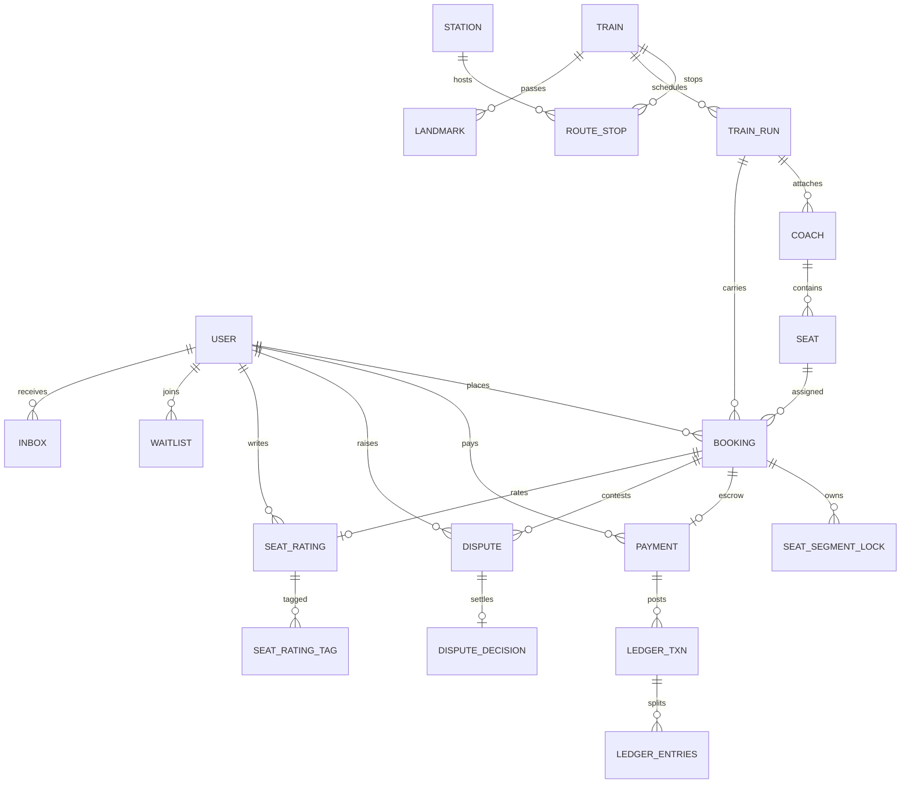

# Relational schema

RailSeat stores one SQLite database per node. The diagram below is the logical schema. `change_log` is the replication journal. `seat_rating_summary` is a maintained aggregate, justified in [normalisation.md](normalisation.md).

## Keys that carry the design

| Relation | Primary key | What it protects |
| --- | --- | --- |
| route_stop | (train_id, stop_idx) | One station per stop of a train |
| seat | seat_id, unique (coach_id, seat_no) | One berth identity inside a coach |
| seat_segment_lock | (run_id, seat_id, segment_idx) | One booking per berth per segment of a run |
| booking | booking_id | The passenger's hold, ticket or cancellation |
| payment_transition | (from_state, to_state) | The legal edges of the escrow machine |
| seat_rating | rating_id, unique (booking_id) | One verified rating per completed ticket |
| seat_rating_summary | (train_id, coach_no, seat_no, from_idx, to_idx) | Cached stars and tag counts |
| change_log | lsn | A single ordered history for replicas |

A journey from stop `i` to stop `j` locks `segment_idx` in `[i, j)`. Two passengers can share a seat when their segments do not overlap. Overlap fails inside the unique key, in the same immediate transaction as the booking insert.

## Views

- `v_seat_availability` — free segments for a run.
- `v_seat_quality` — Bayesian rating from the summary and the global mean.
- `v_replica_lag` — applied LSN against the log head.
- `v_unbalanced_txns` — ledger transactions whose entries do not sum to zero.
- `v_account_balances` — escrow, revenue, wallet, gateway, refund pool.

## What is not a table

Holds are bookings with status `HELD` and a `hold_expires_at`. The lock rows already exist, so expiry is an update plus a delete of those locks, not a second inventory table. Part II of the specification replaces the earlier `seat_hold` sketch with this.
